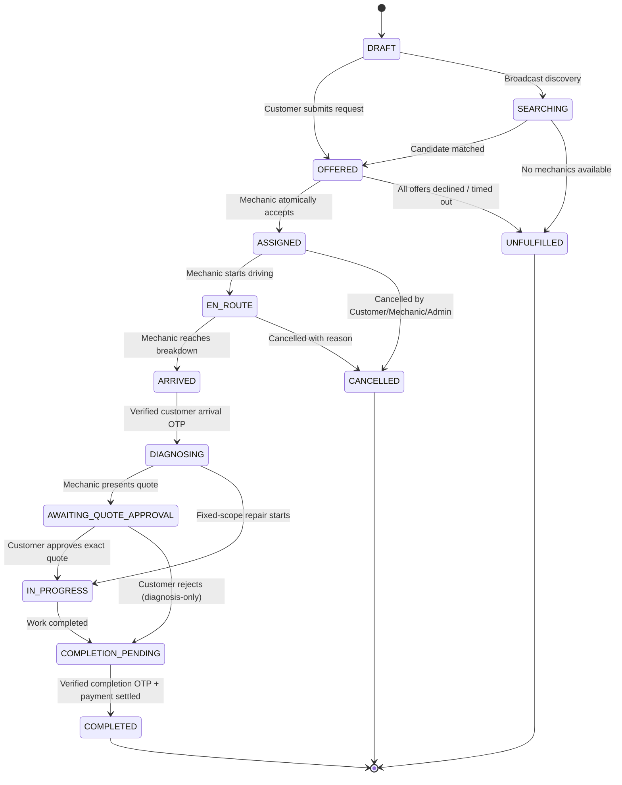

# RoadSaathi

> **Local mechanics. Reliable roadside help.**  
> Market: India (Pilot: Mangaluru & Coastal Karnataka)  
> Visual Identity: Light-blue palette (`#F5FAFF` base, `#2563EB` primary, `#DBEAFE` surface, `#0F172A` text, `#475569` muted)

---

## 1. Product Overview

**RoadSaathi** is an on-demand roadside assistance marketplace connecting stranded motorists with nearby verified independent mechanics, tyre puncture shops, battery specialists, mobile mechanics, and towing fleets.

### Core Customer Journey
```
Report Problem ➔ Confirm Location / Landmark ➔ Compare Nearby Providers ➔ 
See Disclosed Fees & Real Road ETA ➔ Book Immediate Help ➔ Track Assigned Mechanic ➔ 
Verify 4-Digit Arrival Code ➔ Approve Itemized Repair Quote ➔ Receive Service ➔ 
Pay via UPI/Card/Cash ➔ Double-Entry Ledger Settlement ➔ Review Provider
```

### Key Architectural Safeguards
1. **Physical Proximity != Roadside Availability**: Garages that only accept workshop visits (`WORKSHOP_ONLY`) are strictly excluded from roadside assistance dispatch.
2. **Atomic Dispatch Acceptance**: Guaranteed at the database transaction layer—simultaneous acceptance by two mechanics can never produce two winners, and one mechanic cannot take two concurrent roadside jobs.
3. **Secret Verification Codes**: Separate 4-digit arrival and completion codes are stored hashed (SHA-256), rate-limited to 5 attempts, and never revealed to the mechanic in advance.
4. **Transparent Integer Paise Pricing**: All monetary figures are calculated on the server in integer paise (`1 INR = 100 paise`). Diagnosis fees are credited towards approved repairs. No additional charges can be added without the customer's explicit approval of an exact quote version.
5. **Double-Entry Ledger**: Tracks customer payments, mechanic earnings, 15% platform commission, and cash-on-completion receivables without fictional gateway balances.

---

## 2. Booking State Machine Lifecycle



---

## 3. Monorepo Architecture

```
roadsaathi/
├── apps/
│   ├── api/          # NestJS modular backend (REST + Socket.IO) on port 3300
│   │   ├── prisma/   # PostgreSQL schema with 24 relational models & seed script
│   │   └── src/      # Modules: auth, discovery, bookings, quotes, payments, ledger, tracking, admin
│   ├── web/          # Next.js public site & protected admin dashboard on port 3301
│   ├── mobile/       # React Native Expo app with Customer + Mechanic role switching
│   └── worker/       # BullMQ durable background worker for dispatch sweeps and notification outbox
├── packages/
│   ├── contracts/    # Shared Zod schemas, TypeScript DTOs, pricing math, state machine rules
│   └── config/       # Base TypeScript and tool configurations
├── docker-compose.yml# Containerized Postgres (PostGIS), Redis, API, Worker, and Web
├── PROJECT_STATUS.md # Current status tracking and execution checkpoint
└── .env.example      # Environment variable template with safe development defaults
```

---

## 4. Quick Start & Setup

### Prerequisites
- Node.js `v20+` or `v24+`
- npm `v10+` or `v11+`
- PostgreSQL 16+ (or Docker)

### 1. Install Dependencies
```bash
npm install
```

### 2. Configure Environment
```bash
cp .env.example .env
cp .env.example apps/api/.env
```

### 3. Database Migration & Pilot Seed
```bash
# Push schema to PostgreSQL
npm run db:migrate

# Seed Mangaluru pilot dataset (6 provider test cases, admins, customers)
npm run db:seed
```

### 4. Run Automated Concurrency & Lifecycle Tests
```bash
# Runs atomic concurrency, single-job constraints, and end-to-end service tests
npm run test --workspace=apps/api
npm run test --workspace=packages/contracts
```

### 5. Launch Services
```bash
# Start NestJS API server (Port 3300)
npm run dev:api

# Start Next.js Public Web & Admin Portal (Port 3301)
npm run dev:web

# Start React Native Mobile App (Expo)
npm run dev:mobile
```

---

## 5. Seeded Mangaluru Pilot Test Accounts

| Role | Name / Business | Phone / Email | Location | Capability / Test Scenario |
| :--- | :--- | :--- | :--- | :--- |
| **Mechanic** | Ramesh Poojary (*Ramesh Auto Electric*) | `+919800000001` | Kadri | Approved, Online, Roadside Ready |
| **Mechanic** | Irfan Sheikh (*Kudla 24x7 Towing*) | `+919800000002` | Kankanady | Approved, Online, 25km Towing Specialist |
| **Mechanic** | Kiran D Souza (*Coastal Tyre Works*) | `+919800000003` | Hampankatta | Approved, Online, Puncture Specialist |
| **Garage** | Manish Bhat (*Precision Workshop*) | `+919800000004` | Baikampady | **Workshop-Only** (Excluded from roadside dispatch) |
| **Mechanic** | Sathish Kulal (*Karavali Motor Clinic*) | `+919800000005` | Surathkal | **Submitted / Under Review** (Excluded until approved) |
| **Mechanic** | Pradeep Salian (*Pradeep Bike Point*) | `+919800000006` | Bejai | **Offline** (Excluded from dispatch) |
| **Customer** | Arjun Kumar | `+919800000101` | Hampankatta | 2022 Hyundai Creta (KA19MD4521) |
| **Customer** | Pooja Hegde | `+919800000102` | Surathkal | 2023 Tata Nexon EV (KA19EV0012) |
| **Admin** | Deepak Rao (Super Admin) | `admin@roadsaathi.in` | Hub | Full permissions (Password: `Password@123`) |

*In development mode, phone OTP verification accepts `123456` for all phone numbers.*

---

## 6. Docker Container Deployment

To launch the complete containerized stack:
```bash
docker compose up -d
```
Services included:
- `roadsaathi-postgres`: PostgreSQL 16 with PostGIS 3.4 (`postgis/postgis:16-3.4`) on port `5432`
- `roadsaathi-redis`: Redis 7 Alpine on port `6379`
- `roadsaathi-api`: NestJS API container on port `3300`
- `roadsaathi-worker`: BullMQ background job worker
- `roadsaathi-web`: Next.js web application on port `3301`

---

## 7. Production Launch Checklist

### Completed in Application Code
- [x] Strict server-side matching & geographic candidate shortlisting
- [x] Physical proximity != roadside availability enforcement (`WORKSHOP_ONLY` excluded)
- [x] Database-level atomic acceptance transaction guarding against race conditions
- [x] Secret 4-digit arrival and completion verification codes (SHA-256 hashed, rate-limited)
- [x] Versioned itemized quotes with explicit customer approval and diagnosis credit
- [x] Integer paise pricing calculations and double-entry platform ledger
- [x] Cash-on-completion reconciliation flow and commission debt tracking
- [x] Authenticated booking-scoped Socket.IO tracking gateway
- [x] Admin operations portal with document review, stale-job alerts, and manual dispatch
- [x] India DPDP Act aligned privacy policy, terms, refund, and grievance disclosures

### External Production Setup Required Prior to Live Operations
- [ ] **Firebase Authentication**: Upload live Google Cloud Service Account credentials (`FIREBASE_CLIENT_EMAIL`, `FIREBASE_PRIVATE_KEY`) for live SMS OTP delivery.
- [ ] **Google Maps Platform**: Obtain a production Google Maps Routes API key with HTTP referrer and IP restrictions enabled.
- [ ] **Razorpay Account & Webhook**: Register merchant KYC on Razorpay, activate UPI Autopay and Marketplace Route settlement, and configure webhook URL `https://api.roadsaathi.in/api/payments/webhook`.
- [ ] **S3 Object Storage**: Set up private AWS S3 or MinIO bucket with CORS configuration for direct pre-signed photo uploads.
- [ ] **Legal Review**: Appoint a statutory Grievance Redressal Officer under the Information Technology (Intermediary Guidelines) Rules 2021.
